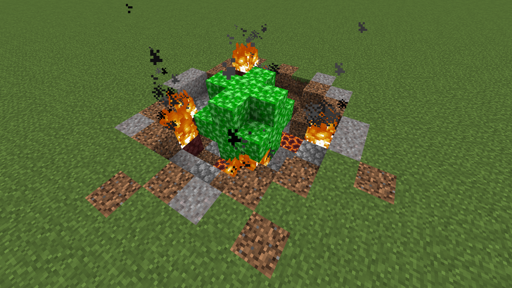

# Kryptonite Meteor

{ width="394" height="220" loading=lazy }

The "**Kryptonian Meteor**" structure can be found in the following biomes:

* minecraft:plains
* minecraft:savanna
* minecraft:snowy_plains

Purpose:

* This structure contains [Kryptonite](../blocks/ores/kryptonite.md) Blocks which can be used to weaken any of the [Kryptonian](../powers/main-powers/kryptonians-full/index.md) or [Half Kryptonian](../powers/main-powers/kryptonians-half/index.md) variants.

Additional Information:

* With cheats enabled, you can use the "/locate structure fsang:kryptonian_meteor" command to find the nearest location to you.
