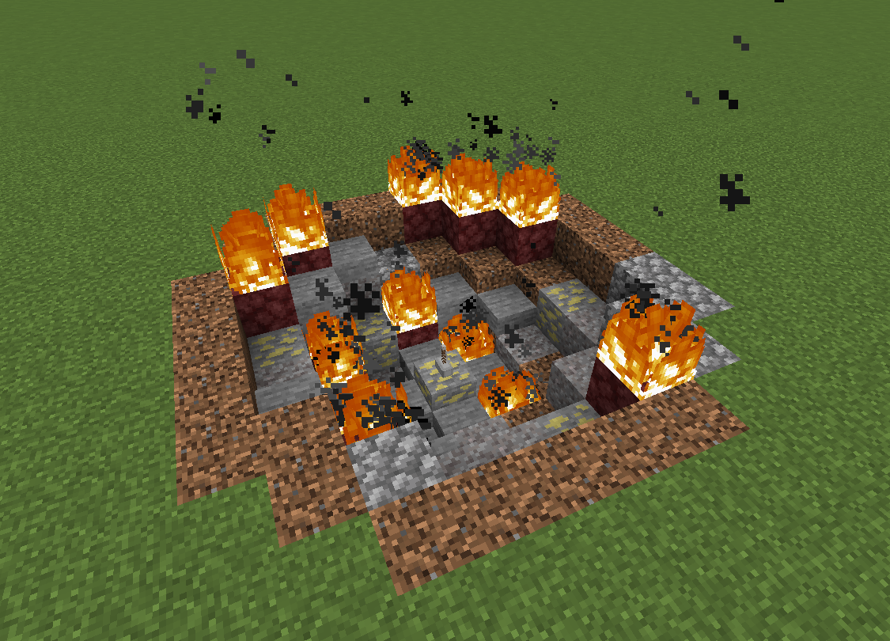

# Mjolnir Crashsite

{ width="458" height="329" loading=lazy }

The **"Mjolnir Crashsite"** structure can be found in the following biomes:

* minecraft:taiga
* minecraft:snowy_taiga
* minecraft:snowy_plains
* minecraft:jagged_peaks
* minecraft:frozen_peaks
* minecraft:snowy_slopes

This meteor can contain [Mjolnirs](../powers/tertiary-powers/mjolnirs/index.md), [Stormbreaker](../powers/tertiary-powers/stormbreaker.md) or [Uru Block](../blocks/ores/uru.md). Finding Mjolnir or Stormbreaker inside the structure is not guarenteed.
