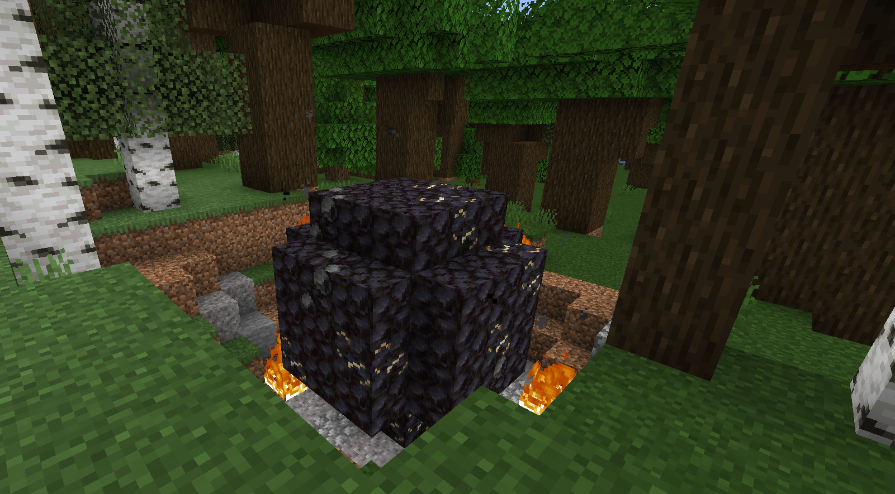

# Nth Meteor

{ width="471" height="260" loading=lazy }

The **"Nth Meteor"** structure can be found in the following biomes:

* minecraft:desert
* minecraft:dark_forest
* minecraft:bamboo_jungle
* minecraft:badlands
* minecraft:meadow
* minecraft:frozen_river
* minecraft:cold_ocean
* minecraft:frozen_ocean

Purpose:

* These meteors are the only source of [Nth Metal](../blocks/ores/nth-metal.md), and also contain [Titanium Ore](../blocks/ores/titanium.md).
