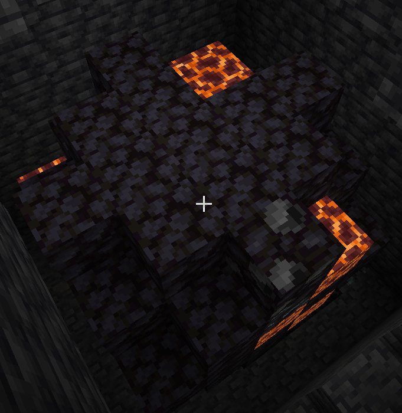
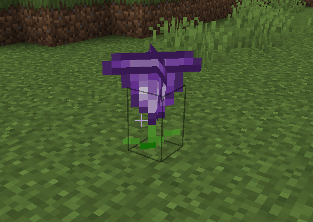

# Vibranium Meteor

This structure can be found in any biome at y = -50 and is indicated by a Heart-Shaped Herb on the surface (The Heart-Shaped Herb requires dirt to be present to spawn)

Meteor:

{ width=511 height=525 loading=lazy }

Heart Shaped Herb:

{ width=468 height=333 loading=lazy }

Purpose:

* These meteors are the only source of [Vibranium Ore](../blocks/ores/vibranium.md), and also contain [Titanium Ore](../blocks/ores/titanium.md)
