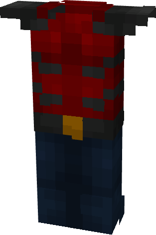

# Aqualad (Young Justice)

{ width="125" height="187" loading=lazy }

**"Aqualad (Young Justice) Suit"** is obtained via:

* x6 Blue Reinforced Fabrics
* x6 Red Reinforced Fabrics
* x1 Nth Template
* Diamond Armor Set

in a Tailoring Bench and can be repaired via "[Nth Ingot](../../blocks/ores/nth-metal.md)".

**Stats:**

* Armor Rating: 14
* Armor Toughness: 4
