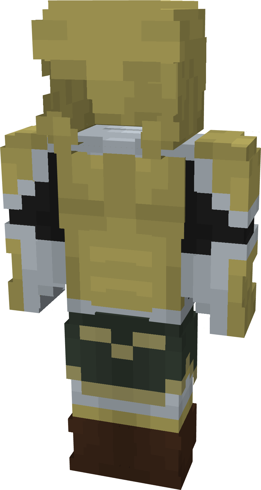

# Asgardian (Soldier)

{ width="162" height="303" loading=lazy }

**"Asgardian (Soldier) Suit"** is obtained via:

* x1 Uru Template
* x4 Green Basic Fabric
* x2 Brown Basic Fabric
* Iron Armor Set

in a Tailoring Bench and can be repaired with "[Uru Ingots](../../blocks/ores/uru.md)".

**Stats**:

* Armor Rating: 22
* Armor Toughness: 8
