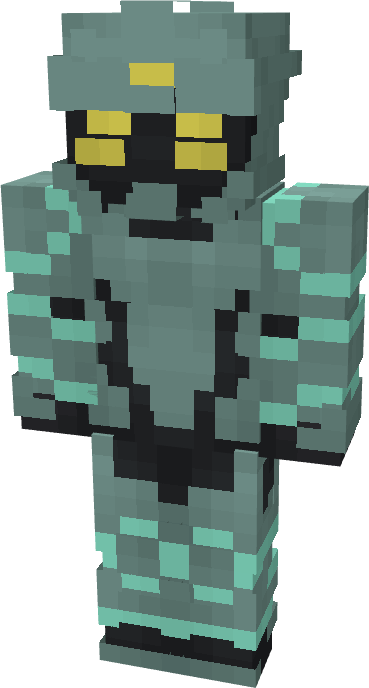

# Atlantean (Soldier)

{ width=197 height=367 loading=lazy }

**"Atlantean (Soldier) Suit"** is obtained via:

* x2 Black Basic Fabrics
* x8 Prismarine Shards
* x1 Heart of the Sea
* x1 Nth Template
* Iron Armor Set

in a Tailoring Bench and can be repaired via "[Nth Ingot](../../blocks/ores/nth-metal.md)".

**Stats**:

* Armor Rating: 22
* Armor Toughness: 8

**Additional Information:** If used with one of the [Atlantean ](../../powers/main-powers/atlanteans/index.md)- Sea Changed variants, this suit can allow that power to breath on land.
