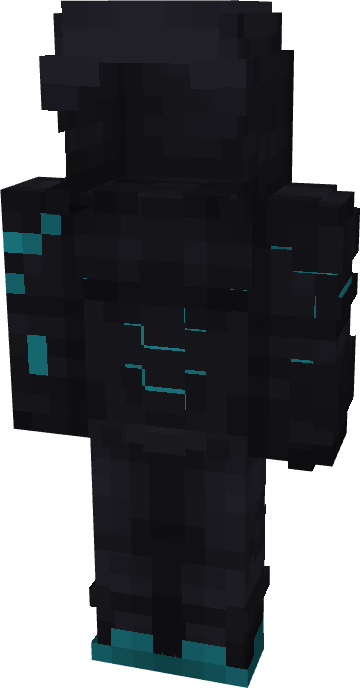

# Babel

{ width=139 height=265 loading=lazy }

**"Babel Suit"** is obtained via:

* x2 Light Blue Reinforced Fabrics
* x2 Black Reinforced Fabrics
* x2 Gray Reinforced Fabrics
* Leather Armor Set

in a Tailoring Bench and can be repaired via "Reinforced Fabric Repair Kit".

**Stats:**

* Armor Rating: 20
* Armor Toughness: 4
