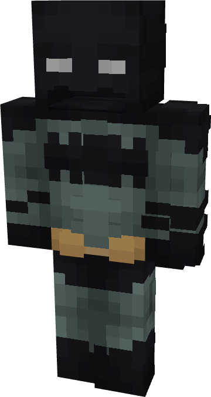

# Batman (Absolute)

{ width=155 height=290 loading=lazy }

**"Batman (Absolute) Suit"** is obtained via transforming [Batman (Classic)](batman-classic.md)(or Owlman and Red Death suits) Armorset inside **Multiversal Iterator** with **"Elseworld"** Multiversal Extrapolator and can be repaired via "Reinforced Fabric Repair Kits".

**Stats**:

* Armor Rating: 20
* Armor Toughness: 4

**Additional Information:** By crouch right-clickin while wearing this suit will give the axe from your chestplate bat emblem. This works like an axe and would be used for combat.
