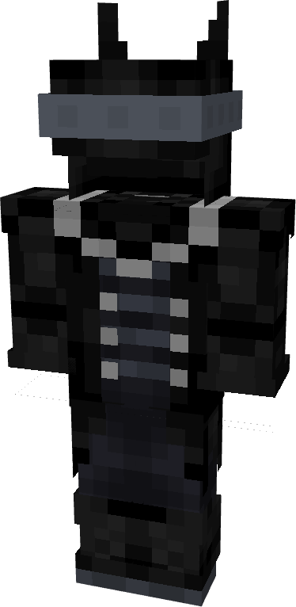

# Batman (Batman Who Laughs)

{ width="196" height="372" loading=lazy }

**"Batman (Batman Who Laughs) Suit"** is obtained via transforming [Batman (Classic)](batman-classic.md) Armorset inside **Multiversal Iterator** with **"Earth-22"** Multiversal Extrapolator and can be repaired via "Reinforced Fabric Repair Kits".

**Stats**:

* Armor Rating: 20
* Armor Toughness: 4
