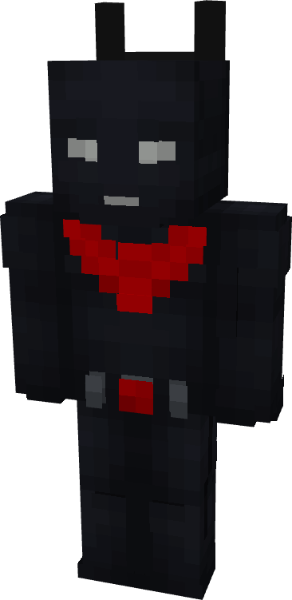

# Batman (Beyond)

{ width=168 height=344 loading=lazy }

**"Batman (Beyond) Suit"** is obtained via:

* x6 Black Tri-Polymer Fabrics
* x2 Red Tri-Polymer Fabrics
* x4 Diamond Circuits
* Batman (Classic) Armor Pieces

in a Tailoring Bench and can be repaired via "Tri-Polymer Fabric Repair Kits".

**Stats**:

* Armor Rating: 22
* Armor Toughness: 8

**Abilities**: When paired with the Batman Beyond Utility Belt thats charged, this suit gains some extra abilities:

* **Slot 1 (Non-Crouch): "Suit Abilities"** - This allows you to choose your desired abilities and activate them. Enabled abilities will drain RF from your belt, you can enable all abilities at once or one by one. Abilities this suit have:
  * **"Night Vision" -** Enable / Disable your night vision.
  * **"Wall Climb" -** Enable / Disable your wall climb. You can climb walls.
  * "**Flight" -** Enable / Disable flight boosters which grant you a max flight speed of 0.75.
  * "**Glide" -** Enable / Disable your wings. You can glide in air with your wings. This glide is similiar to elytra.
  * **"Strength" -** Enable / Disable your claws. Gain +3 attack damage and you can use your both hands in combat.
  * **"Stealth" -** Enable / Disable your camouflage. You can turn invisible. This is not true invisiblity your shadow will stay while in this form.
