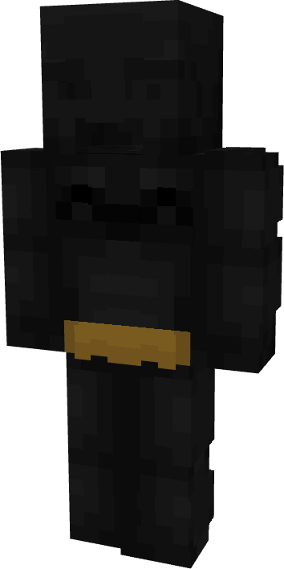

# Batman (Dark Knight)

{ width=170 height=340 loading=lazy }

**"Batman (Dark Knight) Suit"** is obtained via:

* x4 Black Reinforced Fabrics
* Batman (Classic) Armor Set

in a Tailoring Bench and can be repaired via "Reinforced Fabric Repair Kits".

**Stats**:

* Armor Rating: 20
* Armor Toughness: 4
