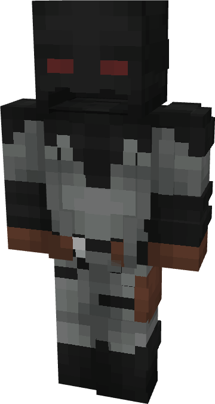

# Batman (Knightfight - Damian Wayne)

{ width="145" height="271" loading=lazy }

**"Batman (Knightfight - Damian Wayne) Suit"** is obtained via:

* x4 Black Basic Fabrics
* x4 Gray Basic Fabrics
* x4 Brown Basic Fabrics
* Robin (Damian Wayne) Armor Set

in a Tailoring Bench and can be repaired via "Reinforced Fabric Repair Kits".

**Stats**:

* Armor Rating: 20
* Armor Toughness: 4
