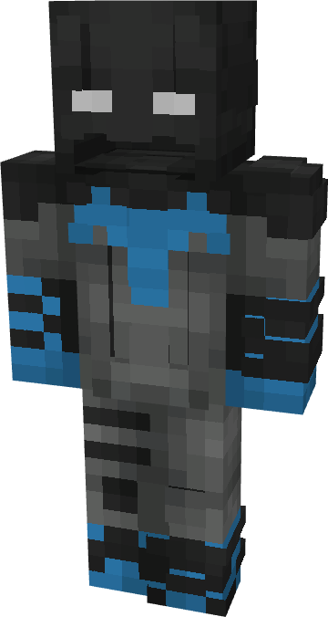

# Batman (Knightfight - Dick Grayson)

{ width="156" height="292" loading=lazy }

**"Batman (Knightfight - Dick Grayson) Suit"** is obtained via:

* x4 Black Basic Fabrics
* x4 Gray Basic Fabrics
* x2 Blue Basic Fabrics
* Nightwing Armor Set

in a Tailoring Bench and can be repaired via "Reinforced Fabric Repair Kits".

**Stats**:

* Armor Rating: 20
* Armor Toughness: 4
