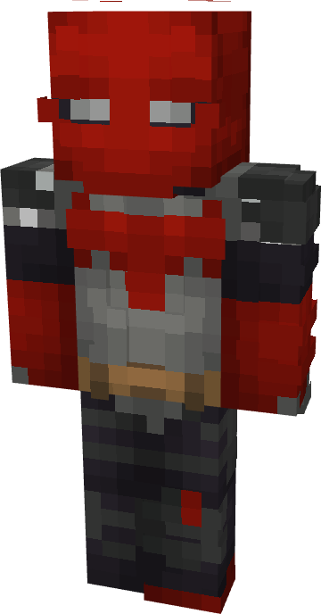

# Batman (Knightfight - Jason Todd)

{ width=173 height=330 loading=lazy }

**"Batman (Knightfight - Jason Todd) Suit"** is obtained via:

* x4 Black Basic Fabrics
* x4 Gray Basic Fabrics
* x2 Red Basic Fabrics
* Red Hood (Rebirth) Armor Set

in a Tailoring Bench and can be repaired via "Reinforced Fabric Repair Kits".

**Stats**:

* Armor Rating: 20
* Armor Toughness: 4
