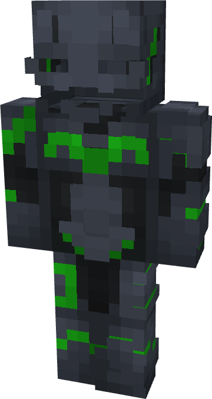

# Batman (Kryptonite)

{ width=196 height=367 loading=lazy }

**"Batman (Kryptonite) Suit"** is obtained via:

* x4 Diamond Circuit
* x4 Titanium Circuit
* x4 [Kryptonite](../../blocks/ores/kryptonite.md) Block
* Batman (Classic) Armor Set

in a Tailoring Bench and can be repaired via "Tri-Polymer Fabric Repair Kits".

**Stats**:

* Armor Rating: 22
* Armor Toughness: 8
