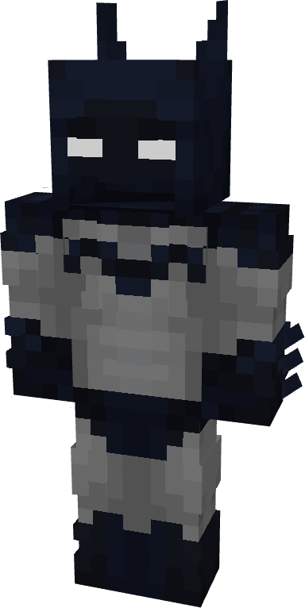

# Batman (Pre-52)

{ width="196" height="372" loading=lazy }

**"Batman (Pre-52) Suit"** is obtained via:

* x6 Black Basic Fabrics
* x6 Grey Basic Fabrics
* Batman (Classic) Armor Pieces

and can be repaired via "Reinforced Fabric Repair Kits".

**Stats**:

* Armor Rating: 20
* Armor Toughness: 4
