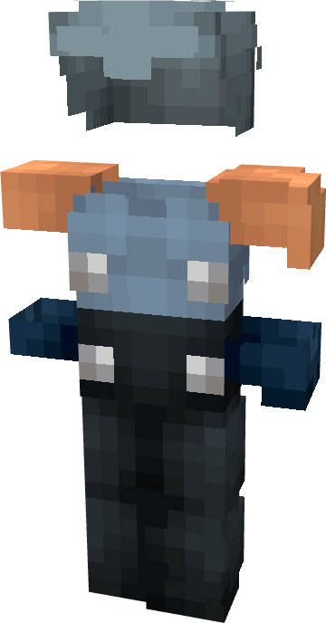

# Beta Ray Bill

{ width=196 height=374 loading=lazy }

**"Beta Ray Bill Suit"** is obtained via:

* x6 Black Tri-Polymer Fabric
* x6 Orange Tri-Polymer Fabric
* x1 Uru Template
* Diamond Armor Set

in a Tailoring Bench and can be repaired via "[Uru ](../../blocks/ores/uru.md)Ingot".

**Stats**:

* Armor Rating: 22
* Armor Toughness: 8
