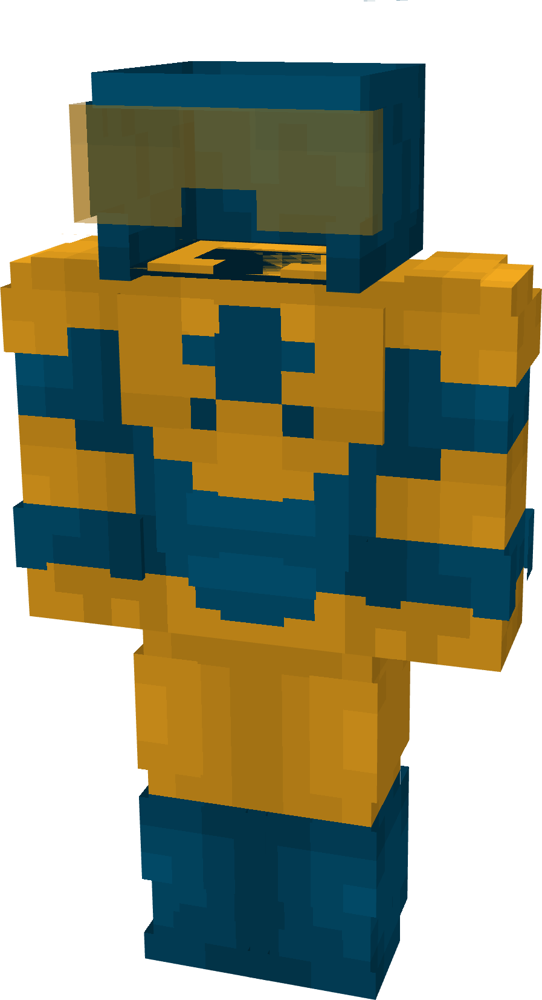

# Booster Gold

{ width="188" height="346" loading=lazy }

**"Booster Gold Suit"** is obtained via:

* x6 Blue Reinforced Fabrics
* x4 Yellow Reinforced Fabrics
* x2 Yellow Stained Glass Pane
* Leather Armor Set

in a Tailoring Bench and can be repaired via "Advanced Fabric Repair Kits".

**Stats**:

* Armor Rating: 20
* Armor Toughness: 4
