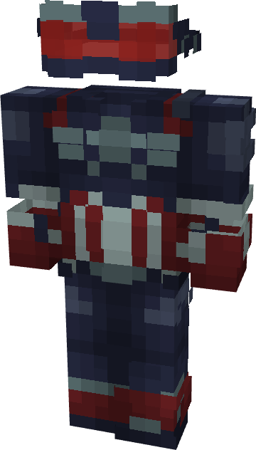

# Captain America (Brave New World)

{ width=231 height=405 loading=lazy }

**"Captain America (Brave New World) Suit"** is obtained via:

* x4 Blue Tri-Polymer Fabric
* x1 Vibranium Template
* x4 Vibranium Circuit
* Captain America (Sam Wilson) Armor Set

in a Tailoring Bench and can be repaired via "[Vibranium](../../blocks/ores/vibranium.md)".

**Stats**:

* Armor Rating: 32
* Armor Toughness: 8

**Additional Information:** You can turn on/off your helmet with open equipment keybind.
