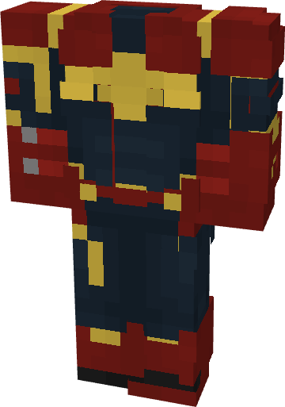

# Captain Marvel (MCU)

{ width=247 height=351 loading=lazy }

**"Captain Marvel (MCU) Suit"** is obtained via transforming Captain Marvel (Comics) Armorset inside **Multiversal Iterator** with **"Earth-199999"** Multiversal Extrapolator and can be repaired via "Reinforced Fabric Repair Kits".

**Stats**:

* Armor Rating: 17
* Armor Toughness: 3
