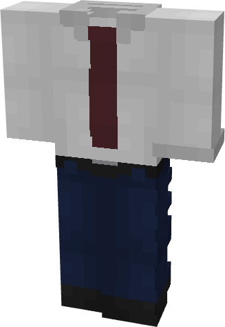

# Constantine

{ width="190" height="275" loading=lazy }

**"Constantine Suit"** is obtained via:

* x4 Black Basic Fabrics
* x4 White Basic Fabrics
* x4 Red Basic Fabrics
* Leather Armor Set

in a Tailoring Bench and can be repaired via "Basic Fabric Repair Kits".

**Stats**:

* Armor Rating: 15
* Armor Toughness: N / A
