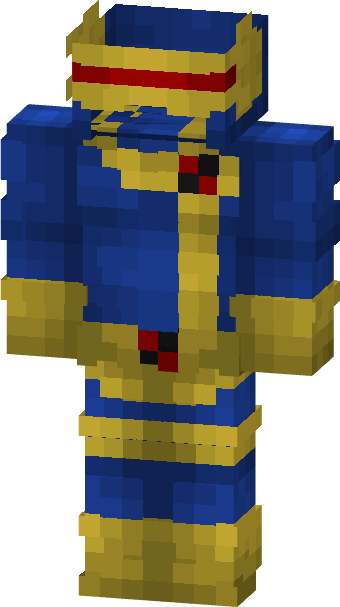

# Cyclops ('97)

{ width="214" height="380" loading=lazy }

**"Cyclops ('97) Suit"** is obtained via transforming [Cyclops ](cyclops.md)Armorset inside **Multiversal Iterator** with **"Earth-92131"** Multiversal Extrapolator and can be repaired via "Reinforced Fabric Repair Kits".

Helmet of this suit can be useable by [Optical Beam](../../powers/main-powers/mutations-x-gene/optical-beam.md) power for help use the power more efficiently.

**Stats**:

* Armor Rating: 20
* Armor Toughness: 4

**Additional Information:** Helmet of this suit can be useable by [Optical Beam](../../powers/main-powers/mutations-x-gene/optical-beam.md) power for help use the power more efficiently.
