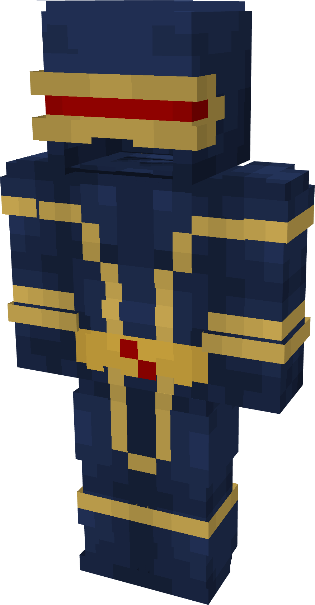

# Cyclops

{ width="143" height="274" loading=lazy }

**"Cyclops Suit"** is obtained via:

* Blue Basic Fabrics
* Cyclops Visor
* Netherite Ingots
* Netherite Smithing Template
* Yellow Basic Fabrics
* Leather Armor Pieces

in a Tailoring Bench and can be repaired via "Reinforced Fabric Repair Kits".

**Stats**:

* Armor Rating: 20
* Armor Toughness: 4

**Additional Information:** Helmet of this suit can be useable by [Optical Beam](../../powers/main-powers/mutations-x-gene/optical-beam.md) power for help use the power more efficiently.
