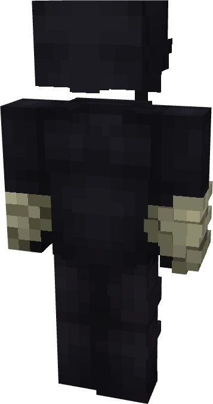

# Daredevil (Starter)

{ width=187 height=353 loading=lazy }

**"Daredevil (Starter) Suit"** is obtained via:

* x4 Black Basic Fabrics
* x4 Gray Basic Fabrics
* Leather Armor Set

in a Tailoring Bench and can be repaired via "Basic Fabric Repair Kits".

**Stats**:

* Armor Rating: 18
* Armor Toughness: N / A
