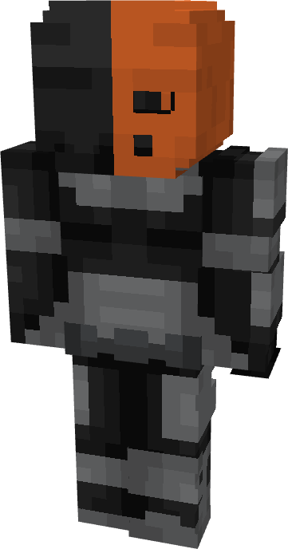

# Deathstroke (Teen Titans)

{ width=154 height=293 loading=lazy }

**"Deathstroke (Teen Titans) Suit"** is obtained via:

* x4 Black Reinforced Fabrics
* x4 Gray Reinforced Fabrics
* x2 Orange Reinforced Fabrics
* Iron Armor Set

in a Tailoring Bench and can be repaired via "Reinforced Fabric Repair Kits".

**Stats**:

* Armor Rating: 20
* Armor Toughness: 4
