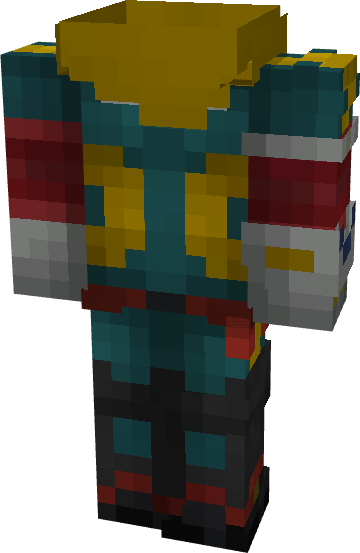

# Deku (Zeta)

{ width=180 height=276 loading=lazy }

**"Deku (Zeta) Suit"** is obtained via:

* x4 Red Basic Fabrics
* x4 Green Basic Fabrics
* x4 Yellow White Fabrics
* x2 White Basic Fabrics
* Leather Armor Set

in a Tailoring Bench and can be repaired via "Reinforced Fabric Repair Kits".

**Stats**:

* Armor Rating: 20
* Armor Toughness: 4
