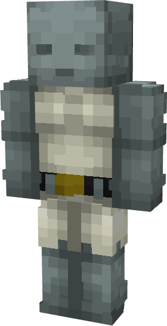

# Dr. Doom (God Emperor)

{ width=187 height=364 loading=lazy }

**"Dr. Doom (God Emperor) Suit"** is obtained via:

* x12 White Tri-Polymer Fabrics
* Dr. Doom (Classic) Armor Set

in a Tailoring Bench and can be repaired via "Tri-Polymer Fabric Repair Kits".

**Stats**:

* Armor Rating: 22
* Armor Toughness: 8
