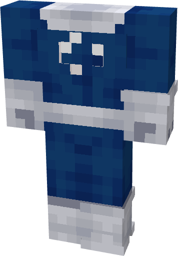

# Fantastic Four (Classic - White)

{ width=190 height=273 loading=lazy }

**"Fantastic Four (Classic - White) Suit"** is obtained via:

* x6 White Reinforced Fabrics
* x2 Blue Reinforced Fabrics
* Iron Armor Set

in a Tailoring Bench and can be repaired via "Reinforced Fabric Repair Kits".

**Stats**:

* Armor Rating: 17
* Armor Toughness: 3
