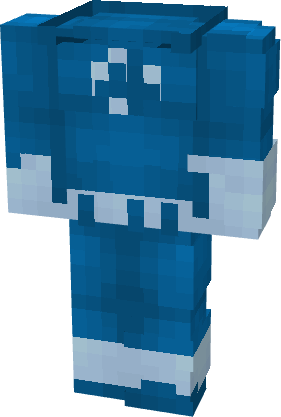
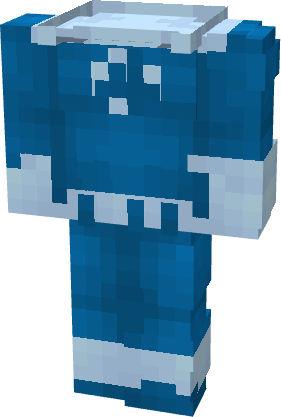
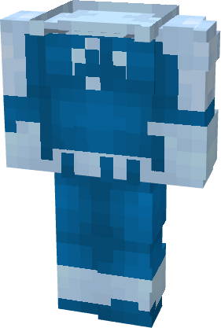
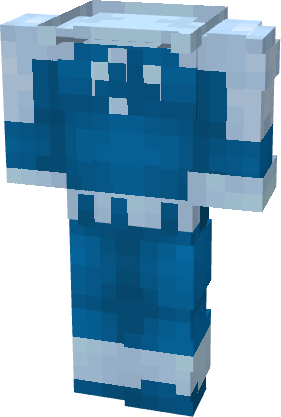

# Fantastic Four (MCU)

{ width=165 height=244 loading=lazy }{ width=166 height=246 loading=lazy }{ width=166 height=246 loading=lazy }{ width=167 height=247 loading=lazy }

**"Fantastic Four (MCU) Suit"** is obtained via transforming Fantastic Four Chestplate inside **Multiversal Iterator** with **"Earth-199999"** Multiversal Extrapolator and can be repaired via "Reinforced Fabric Repair Kits".

**Stats**:

* Armor Rating: 17
* Armor Toughness: 3

**Additional Information:** This suit has four different variant for chestplate. Different chestplate seen above are in order:

* Reed
* Sue
* Johnny
* Ben
