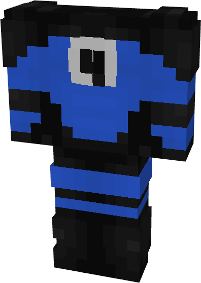

# Fantastic Four

{ width="196" height="372" loading=lazy }

**"Fantastic Four Suit"** is obtained via:

* x4 Blue Reinforced Fabric
* x4 Black Reinforced Fabric
* Iron Armor Set

in a Tailoring Bench and can be repaired via "Advanced Fabric Repair Kits".

**Stats**:

* Armor Rating: 17
* Armor Toughness: 3

**Additional Information**: This suit can be used with [The Human Torch](../../powers/main-powers/cosmic-radiated-individuals/pyrogenesis.md) without being burned away.
