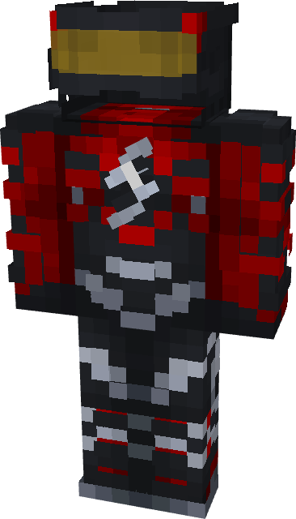

# Flash (Absolute)

{ width=174 height=303 loading=lazy }

**"Flash (Absolute) Suit"** is obtained via:

* x4 Black Reinforced Fabrics
* x4 Red Reinforced Fabrics
* x2 Yellow Stained Glass
* Iron Armor Set

in a Tailoring Bench and can be repaired via "Reinforced Fabric Repair Kits".

**Stats**:

* Armor Rating: 20
* Armor Toughness: 4
