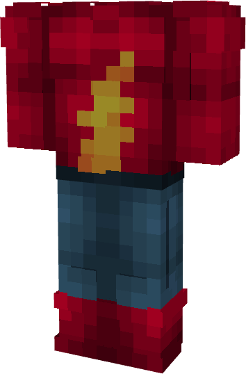

# Flash (Jay Garric - Comics)

{ width=200 height=303 loading=lazy }

**"Flash (Jay Garric - Comics) Suit"** is obtained via:

* x4 Red Basic Fabrics
* x2 Blue Basic Fabrics
* x2 Yellow Basic Fabrics
* x2 Iron Ingot
* Iron Armor Set

in a Tailoring Bench and can be repaired via "Basic Fabric Repair Kits".

**Stats**:

* Armor Rating: 18
* Armor Toughness: N / A
