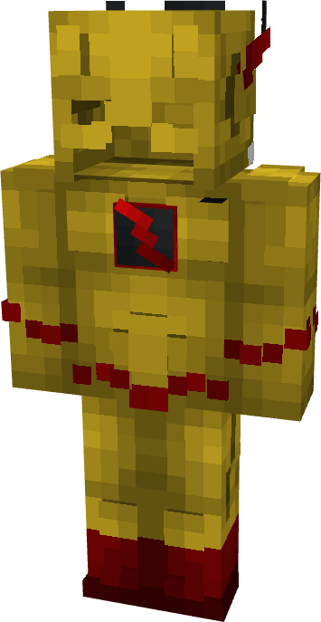

# Reverse Flash (Classic)

{ width=205 height=395 loading=lazy }

**"Reverse Flash (Classic) Suit"** is obtained via:

* x4 Yellow Basic Fabrics
* x4 Red Basic Fabrics
* x2 Black Basic Fabrics
* Leather Armor Set

in a Tailoring Bench and can be repaired via "Basic Fabric Repair Kits".

**Stats**:

* Armor Rating: 18
* Armor Toughness: N / A
