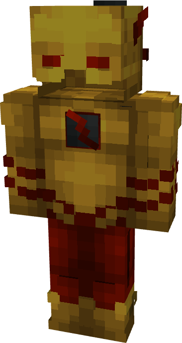

# Reverse Flash (Dark Multiverse)

{ width=197 height=369 loading=lazy }

**"Reverse Flash (Dark Multiverse) Suit"** is obtained via transforming Reverse Flash (Classic) Armorset inside **Multiversal Iterator** with **"Earth-22"** Multiversal Extrapolator and can be repaired via "BasicFabric Repair Kits".

**Stats**:

* Armor Rating: 18
* Armor Toughness: N / A
