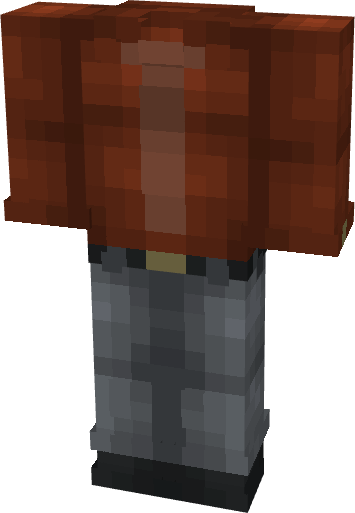

# Formal (Red)

{ width=190 height=274 loading=lazy }

**"Formal (Red) Suit"** is obtained via:

* x4 Red Basic Fabrics
* x4 Gray Basic Fabrics
* x2 Orange Basic Fabrics
* Leather Armor Set

in a Tailoring Bench and can be repaired via "Basic Fabric Repair Kits".

**Stats**:

* Armor Rating: 15
* Armor Toughness: N / A
