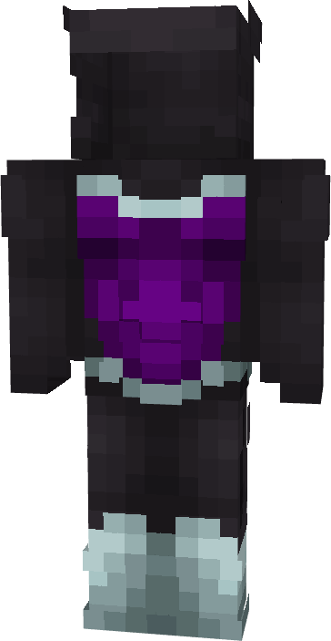

# Gambit (Deadpool & Wolverine)

{ width=167 height=322 loading=lazy }

**"Gambit (Deadpool & Wolverine) Suit"** is obtained via:

* x4 Purple Reinforced Fabrics
* x2 Black Reinforced Fabrics
* Iron Armor Set

in a Tailoring Bench and can be repaired via "Reinforced Fabric Repair Kits".

**Stats**:

* Armor Rating: 20
* Armor Toughness: 4
