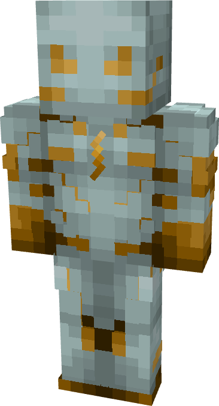

# Godspeed (Comics)

{ width=168 height=310 loading=lazy }

**"Godspeed (Comics) Suit"** is obtained via:

* x4 White Basic Fabrics
* x4 Yellow Basic Fabrics
* Leather Armor Set

in a Tailoring Bench and can be repaired via "Basic Fabric Repair Kits".

**Stats**:

* Armor Rating: 18
* Armor Toughness: N / A
