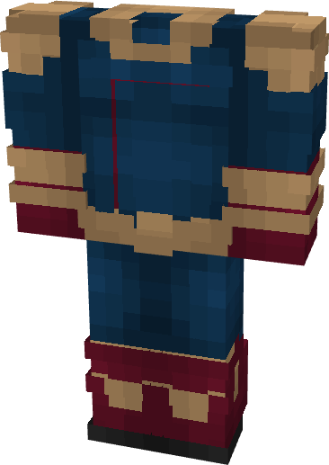

# Homelander

{ width=163 height=230 loading=lazy }

**"Homelander Suit"** is obtained via:

* x4 Red Reinforced Fabrics
* x4 Blue Reinforced Fabrics
* x2 Black Reinforced Fabrics
* x2 Yellow Reinforced Fabrics
* Iron Armor Set

in a Tailoring Bench and can be repaired via "Reinforced Fabric Repair Kits".

**Stats**:

* Armor Rating: 17
* Armor Toughness: 3
