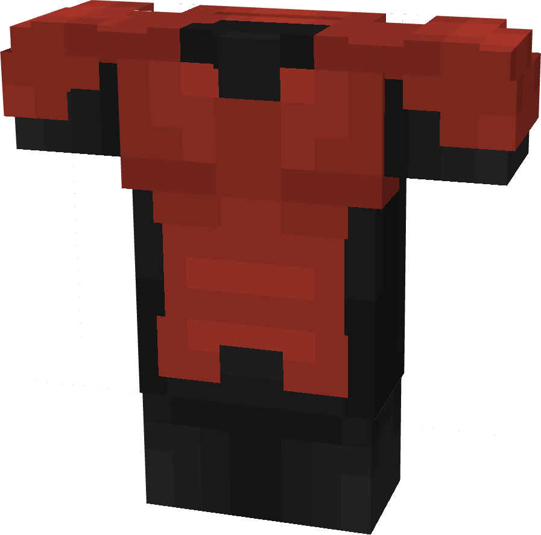

# Iceman (X-Haven)

{ width=221 height=218 loading=lazy }

**"Iceman (X-Haven) Suit"** is obtained via:

* Gray Basic Fabrics
* Red Basic Fabrics
* Leather Armor Pieces

and can be repaired via "Basic Fabric Repair Kits".

**Stats**:

* Armor Rating: 12
