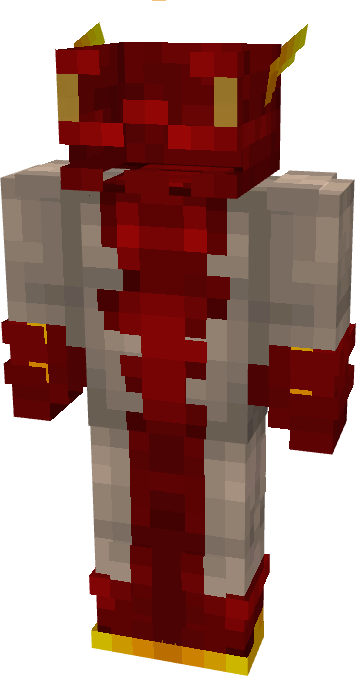

# Impulse

{ width=169 height=320 loading=lazy }

**"Impulse Suit"** is obtained via:

* x4 Red Basic  Fabrics
* x2 White Basic Fabrics
* x4 Yellow Basic Fabrics
* Iron Armor Set

in a Tailoring Bench and can be repaired via "Basic Fabric Repair Kits".

**Stats**:

* Armor Rating: 18
* Armor Toughness: N / A
