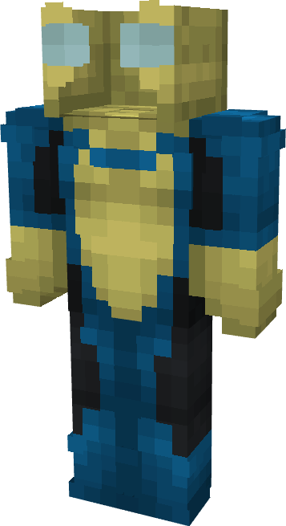

# Invincible (Gogglesvincible)

{ width=188 height=343 loading=lazy }

**"Invincible (Gogglesvincible) Suit"** is obtained via transforming Invincible (Original) Armorset inside **Multiversal Iterator** with **"Earth-GOG28172"** Multiversal Extrapolator and can be repaired via "Reinforced Fabric Repair Kits".

**Stats**:

* Armor Rating: 20
* Armor Toughness: 4
