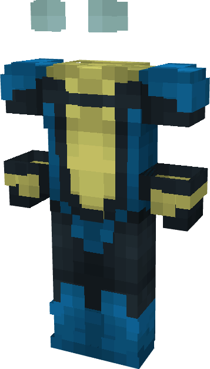

# Invincible (Hairincible)

{ width=199 height=348 loading=lazy }

**"Invincible (Hairincible) Suit"** is obtained via transforming Invincible (Original) Armorset inside **Multiversal Iterator** with **"Earth-HAR18227"** Multiversal Extrapolator and can be repaired via "Reinforced Fabric Repair Kits".

**Stats**:

* Armor Rating: 20
* Armor Toughness: 4
