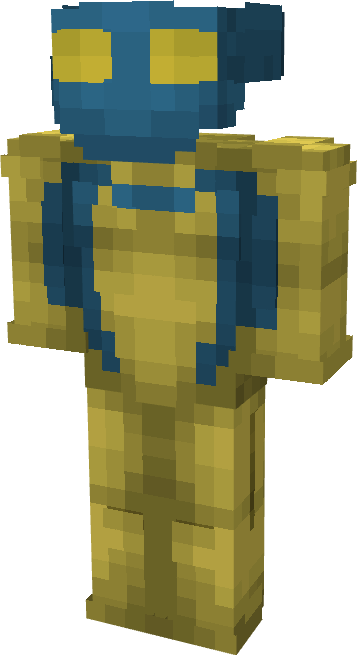

# Invincible (Hoodvincible)

{ width=173 height=316 loading=lazy }

**"Invincible (Hoodvincible) Suit"** is obtained via transforming Invincible (Original) Armorset inside **Multiversal Iterator** with **"Earth-HOD21442"** Multiversal Extrapolator and can be repaired via "Reinforced Fabric Repair Kits".

**Stats**:

* Armor Rating: 20
* Armor Toughness: 4
