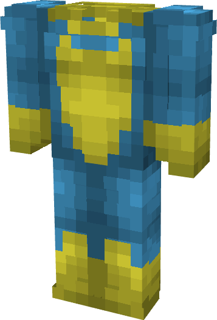

# Invincible (Lightblueincible)

{ width=170 height=250 loading=lazy }

**"Invincible (Lightblueincible) Suit"** is obtained via transforming Invincible (Original) Armorset inside **Multiversal Iterator** with **"Earth-LBL48996"** Multiversal Extrapolator and can be repaired via "Reinforced Fabric Repair Kits".

**Stats**:

* Armor Rating: 20
* Armor Toughness: 4
