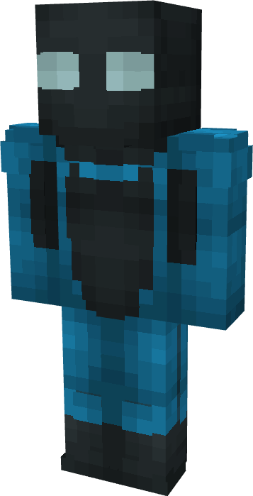

# Invincible (Maskvincible)

{ width=172 height=336 loading=lazy }

**"Invincible (Maskvincible) Suit"** is obtained via transforming Invincible (Original) Armorset inside **Multiversal Iterator** with **"Earth-MSK24444"** Multiversal Extrapolator and can be repaired via "Reinforced Fabric Repair Kits".

**Stats**:

* Armor Rating: 20
* Armor Toughness: 4
