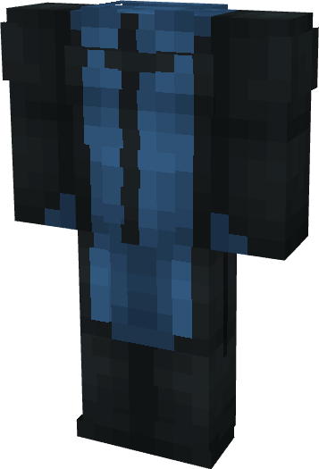

# Invincible (Mohawk)

{ width=212 height=311 loading=lazy }

**"Invincible (Mohawk) Suit"** is obtained via transforming Invincible (Original) Armorset inside **Multiversal Iterator** with **"Earth-MHK27171"** Multiversal Extrapolator and can be repaired via "Reinforced Fabric Repair Kits".

**Stats**:

* Armor Rating: 17
* Armor Toughness: 3
