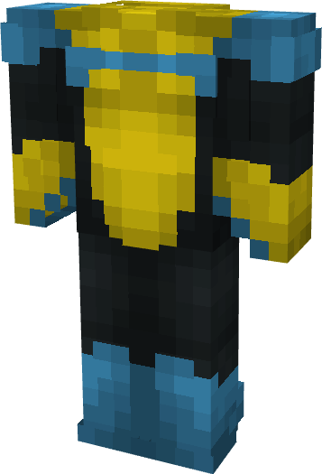

# Invincible (Nomaskible)

{ width=229 height=336 loading=lazy }

**"Invincible (Nomaskible) Suit"** is obtained via transforming Invincible (Original) Armorset inside **Multiversal Iterator** with **"Earth-NMK27373"** Multiversal Extrapolator and can be repaired via "Reinforced Fabric Repair Kits".

**Stats**:

* Armor Rating: 17
* Armor Toughness: 3
