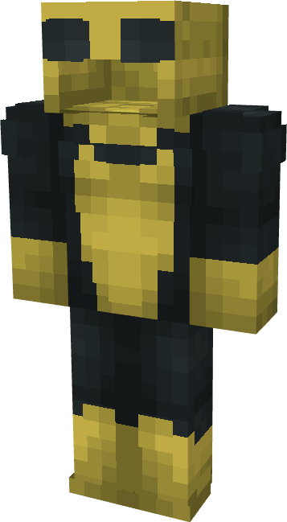

# Invincible (Sinister)

{ width=197 height=357 loading=lazy }

**"Invincible (Sinister) Suit"** is obtained via transforming Invincible (Original) Armorset inside **Multiversal Iterator** with **"Earth-SIN17538-M"** Multiversal Extrapolator and can be repaired via "Reinforced Fabric Repair Kits".

**Stats**:

* Armor Rating: 20
* Armor Toughness: 4
