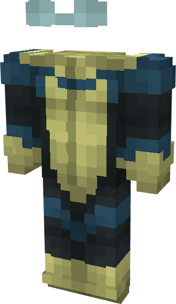

# Invincible (Sportvincible)

{ width=203 height=348 loading=lazy }

**"Invincible (Sportvincible) Suit"** is obtained via transforming Invincible (Original) Armorset inside **Multiversal Iterator** with **"Earth-SPT32107"** Multiversal Extrapolator and can be repaired via "Reinforced Fabric Repair Kits".

**Stats**:

* Armor Rating: 20
* Armor Toughness: 4
